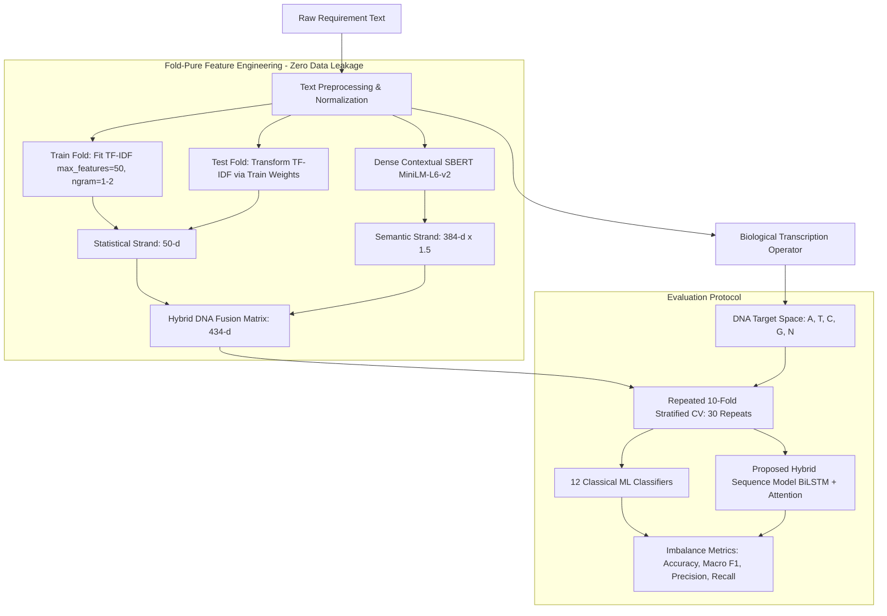

# DNA-Inspired Software Requirements Classifier (Phase 2 Framework)

[](https://www.python.org/)
[](https://opensource.org/licenses/MIT)
[]()
[](https://github.com/psf/black)

A production-grade, bio-inspired machine learning framework that implements **Phase 2: DNA-Inspired Feature Engineering & Requirements Classification Framework** as part of the research work on:
**"An Effective Hybrid Sequence Model for Automated Software Requirement Classification Through Deep Representation Learning"**.

This framework maps software requirement classes into genetic DNA bases (A, T, C, G, N), extracts a hybrid feature space fusing fold-isolated TF-IDF lexical metrics with dense SBERT sentence embeddings, computes 2D $(AT, GC)$ biological projections, and validates stability across Repeated 10-Fold Stratified Cross-Validation with strict fold-pure isolation (zero data leakage).

---

## 🧬 Methodology & Metaphorical Mapping

The framework encodes linguistic requirement rules into DNA-like sequences to build robust feature maps:

### 1. Symbolic DNA Base Target Mapping
Classes from the **PROMISE NFR dataset** are mapped into genetic bases (Section 6.9, Eq. 3–4):
*   **Adenine (A)**: Functional Requirements (`F`)
*   **Thymine (T)**: Usability Requirements (`US`)
*   **Guanine (G)**: Performance Requirements (`PE`)
*   **Cytosine (C)**: Security Requirements (`SE`)
*   **Neutral (N)**: All other Non-Functional Requirements (`LF`, `MN`, `SC`, `FT`, `L`, `PO`, `O`, and Availability `A`)

### 2. Dual-Strand Hybrid Feature Fusion
The input text space is transformed using a biologically inspired dual-strand architecture (Section 6.10, Eq. 5–10):

$$\mathbf{x}_i = \left[ \mathbf{v}_i^{\text{TF-IDF}} \;\parallel\; \gamma \cdot \mathbf{v}_i^{\text{SBERT}} \right] \in \mathbb{R}^{434}, \quad \text{where } \gamma = 1.5$$

*   **Statistical Strand (TF-IDF)**: Word and bigram TF-IDF restricted to the top 50 features with sublinear term frequency scaling, fitted **strictly on training folds** to guarantee zero data leakage.
*   **Semantic Strand (SBERT)**: Dense 384-dimensional sentence embeddings generated via the `all-MiniLM-L6-v2` transformer model (scaled by the empirical golden factor $\gamma = 1.5$).
*   **2D (AT, GC) Bio-Symbolic Separability**: Auxiliary nucleotide count vectors and $(AT, GC)$ coordinate projections for visual domain separability and interpretability.

---

## 🗺️ System Architecture & Workflow



---

## 📊 Phase 2 Benchmark Evaluation (PROMISE Dataset)

The framework evaluates performance across **12 algorithms** using **Repeated 10-Fold Stratified Cross-Validation with 30 randomized splits** per fold (totaling exactly **3,600 model evaluations**) with strict fold-pure isolation:

### Baseline Accuracy & Macro F1 (30x10 Repeated CV)

| Rank | Algorithm | Mean Accuracy (%) | Acc Std (%) | Mean Macro F1 (%) | F1 Std (%) |
| :---: | :--- | :---: | :---: | :---: | :---: |
| 🥇 1 | **SVM RBF** | **84.21%** | $\pm 2.56\%$ | **81.12%** | $\pm 2.85\%$ |
| 🥈 2 | **SVM Linear** | **82.86%** | $\pm 2.99\%$ | **79.94%** | $\pm 3.10\%$ |
| 🥉 3 | **Logistic Regression** | **81.42%** | $\pm 3.28\%$ | **78.85%** | $\pm 3.22\%$ |
| 4 | **KNN (k=3)** | **77.09%** | $\pm 3.18\%$ | **69.80%** | $\pm 3.45\%$ |
| 5 | **Gradient Boosting** | **76.36%** | $\pm 3.86\%$ | **68.90%** | $\pm 3.75\%$ |
| 6 | **KNN (k=5)** | **75.95%** | $\pm 2.01\%$ | **68.42%** | $\pm 2.30\%$ |
| 7 | **KNN (k=7)** | **75.02%** | $\pm 1.95\%$ | **66.15%** | $\pm 2.25\%$ |
| 8 | **Random Forest** | **68.32%** | $\pm 3.67\%$ | **53.18%** | $\pm 4.10\%$ |
| 9 | **AdaBoost** | **61.41%** | $\pm 4.76\%$ | **50.62%** | $\pm 4.35\%$ |
| 10 | **Decision Tree** | **54.50%** | $\pm 5.07\%$ | **46.20%** | $\pm 4.70\%$ |
| 11 | **Multinomial NB (MinMax)** | **49.74%** | $\pm 1.62\%$ | **32.40%** | $\pm 2.15\%$ |
| 12 | **Naive Bayes (Gaussian)** | **42.20%** | $\pm 5.58\%$ | **41.80%** | $\pm 4.90\%$ |

---

## 🌍 Zero-Shot Generalizability (FNFC Dataset)

To verify that the DNA-inspired hybrid representation generalizes to unseen software domains, models were trained on PROMISE (969 requirements) and tested blind on **7,060 unseen FNFC requirements**:

| Algorithm | Zero-Shot Accuracy (%) | Zero-Shot Macro F1 (%) |
| :--- | :---: | :---: |
| **SVM RBF** | **77.58%** | **52.89%** |
| **Logistic Regression** | **76.93%** | **52.45%** |
| **SVM Linear** | **72.72%** | **47.10%** |
| **Random Forest** | **83.27%** | **45.06%** |
| **Gradient Boosting** | **77.88%** | **43.68%** |

---

## 🔬 Generated Verification Plots

| Confusion Matrix (PROMISE) | Multi-Class ROC AUC | 2D (AT, GC) Bio-Separability |
|:---:|:---:|:---:|
|  |  |  |

---

## 🚀 Quickstart Guide

### 1. Installation
```bash
git clone https://github.com/umertanveer25/DNA-Req.git
cd DNA-Req
pip install -r requirements.txt
```

### 2. Run Repeated 10-Fold CV Pipeline (Zero Data Leakage)
Run in demo mode (1 repeat of 10 folds):
```bash
python run_pipeline.py --demo
```
Run the full 30-repeat benchmark suite (3,600 evaluations):
```bash
python run_pipeline.py
```
Include the proposed **Hybrid Deep Sequence Model** (BiLSTM + Attention):
```bash
python run_pipeline.py --demo --include_sequence_model
```

### 3. Generate Publication Plots
Generates Confusion Matrices, ROC-AUC curves, and 2D (AT, GC) Bio-Symbolic Separability plots:
```bash
python generate_plots.py
```

### 4. Run Gamma (γ) Scaling Sensitivity Analysis
Generates empirical ablation tables and sensitivity curves across $\gamma \in [0.0, 2.5]$:
```bash
python ablation_gamma.py
```

### 5. Run Zero-Shot Cross-Dataset Benchmark (FNFC)
```bash
python evaluate_fnfc_all.py
```

### 6. Run Unit Tests
```bash
python -m pytest tests/
```

---

## 📄 Citation
If you use this framework or reference our findings in your research, please cite:
```bibtex
@phdthesis{tanveer2026hybrid,
  title={An Effective Hybrid Sequence Model for Automated Software Requirement Classification Through Deep Representation Learning},
  author={Tanveer, Umer},
  school={Abdul Wali Khan University Mardan},
  year={2026}
}
```
